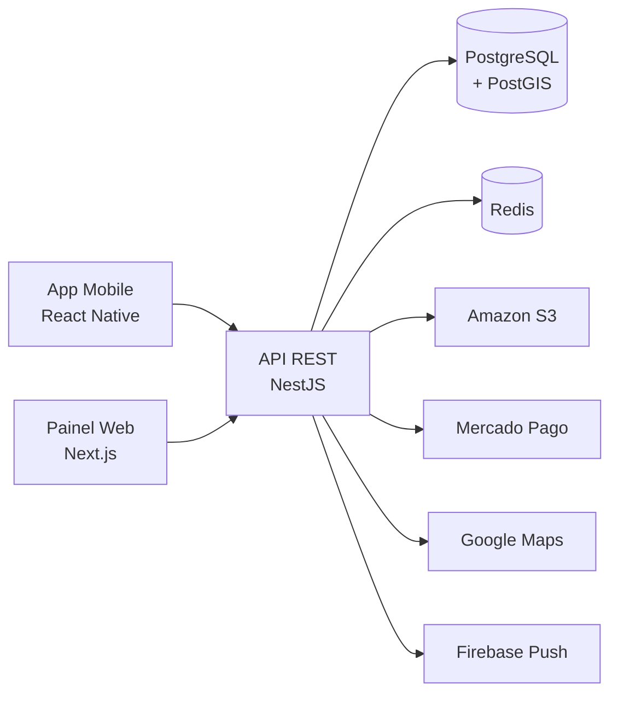

# 🌱 Raiz Express


**Raiz Express** é um aplicativo de delivery inspirado no iFood, mas voltado para **produtos da agricultura familiar e de pequenos produtores locais**: hortifrúti, ovos, queijos, mel e pães artesanais.

O objetivo é encurtar o caminho entre quem planta e quem come. O consumidor sabe exatamente de onde vem cada alimento, e o produtor vende direto, sem atravessador e com um painel simples para controlar pedidos e estoque.

> **Do produtor para a sua mesa.**

---

## 🚀 Principais Funcionalidades

### 🛒 Para o Consumidor

- **Busca por proximidade:** encontra produtores e produtos num raio de poucos quilômetros.
- **Origem transparente:** cada item mostra a propriedade, o produtor e o horário da colheita.
- **Pagamento rápido:** Pix com confirmação instantânea (via Webhooks) ou cartão de crédito.
- **Acompanhamento em tempo real:** mapa com a rota do entregador e status de cada etapa do pedido.

### 🧑‍🌾 Para o Produtor

- **Painel web:** cadastro de produtos, controle de estoque e agenda de colheita.
- **Gestão de pedidos:** aceitar, preparar e marcar como pronto em poucos cliques.
- **Relatórios de vendas:** produtos mais vendidos e faturamento por período.

### 🚚 Para o Entregador

- **Rotas agrupadas:** pedidos próximos entram na mesma rota, reduzindo o custo de frete.
- **Confirmação com foto:** comprovante de entrega registrado no app.

### 💡 Diferenciais

- 🧺 **Cestas por assinatura:** semanal ou quinzenal, com itens da safra.
- 🍅 **Selo "Colhido hoje":** destaque para produtos colhidos no mesmo dia.
- ⭐ **Avaliações:** consumidores avaliam produtos e produtores.

---

## 🛠️ Tecnologias Utilizadas

- **Mobile:**  
- **Front-end Web:**   
- **Back-end:**   
- **Banco de Dados:**  
- **Cloud e Infraestrutura:**   
- **Integrações:**   
- **Design:** 

### Visão geral da arquitetura



---

## 🔄 Metodologias

### Por que Espiral e não Cascata?

| Critério | Cascata | Espiral | Nossa situação |
|---|---|---|---|
| Requisitos mudam no caminho? | Difícil de lidar | Aceita bem | **Mudam muito**: vamos descobrir o que o produtor realmente precisa |
| Há riscos técnicos altos? | Aparecem só no final | Análise de risco a cada ciclo | **Sim**: pagamento, geolocalização e tempo real |
| Dá para entregar por partes? | Só no fim | Protótipo a cada volta | **Sim**: queremos validar cedo com produtores reais |

O Cascata supõe que sabemos tudo antes de começar, o que não é verdade num marketplace de dois lados. No **Espiral**, cada volta passa por **planejamento → análise de riscos → desenvolvimento e testes → avaliação**.

### Ciclos planejados

| Ciclo | Objetivo | Risco analisado | Entregável |
|---|---|---|---|
| 1 | Validar a ideia | Produtores não adotarem o app | Protótipo no Figma |
| 2 | Catálogo funcional | Busca por proximidade lenta | Cadastro, busca e carrinho |
| 3 | Fluxo de compra | Falhas no pagamento | Pedido pago de ponta a ponta |
| 4 | Logística | Rastreamento instável | Entrega em tempo real |
| 5 | Retenção | Complexidade das assinaturas | Cestas recorrentes |

### Uso de Git e GitHub

```
main        → versão estável
develop     → integração das funcionalidades
feature/*   → uma branch por funcionalidade
fix/*       → correções
docs/*      → documentação
```

1. **Nunca** commitar direto na `main` ou na `develop`.
2. Toda mudança entra por **Pull Request**, com pelo menos **1 revisão**.
3. Cada tarefa vira uma **Issue**, referenciada no PR (`Closes #12`).
4. Mensagens de commit no padrão [Conventional Commits](https://www.conventionalcommits.org/pt-br/): `feat:`, `fix:`, `docs:`, `refactor:`, `test:`.
5. Versões marcadas com **tags** (`v0.1.0`, `v1.0.0`).

---

## 🏁 Diagramas e Telas

- [Caso de Uso](Diagramas/Caso%20de%20Uso.md)
- [Raiz Express no Figma](https://www.figma.com/design/kMyWXu8UDGKctp73x8O0U8)

---

## 🎯 Próximos Passos do Desenvolvimento

- [x] Definir o escopo e as funcionalidades principais.
- [x] Desenhar o protótipo das telas no Figma.
- [ ] Validar o protótipo com produtores e consumidores reais.
- [ ] Criar o MVP focado no fluxo: busca → carrinho → pagamento Pix.
- [ ] Desenvolver o painel do produtor.
- [ ] Integrar entrega e rastreamento em tempo real.
- [ ] Implementar as cestas por assinatura.

---

Desenvolvido com ☕ por ***Kauan Salles Alves***
